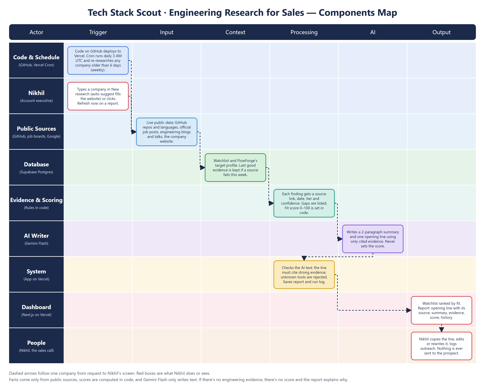

# Tech Stack Scout

Turns public engineering signals into **evidence-backed tech-stack intelligence** and a personalized
sales-call opening line for **FlowForge**'s target accounts, refreshed automatically every week.

> MESA Cohort C4 · AI and its Applications · Section 1 Final · Problem Statement 4.
> Built to the *Tech Stack Scout — Final Architecture Document* (v1.0); section numbers below (§) refer to it.

**Principles:** evidence before AI · every finding traceable to a source · unknowns shown, never guessed ·
edits change wording, never evidence · everything works in the deployed app with live data.

## What Nikhil sees

The interface shows the essentials first and keeps everything else one click away, so a rep isn't
faced with every feature at once. The layout follows common AI-assistant and CRM patterns on Dribbble:
a centered start screen, calm list rows, and tabbed company profiles.

**Left sidebar (every page):** New research · Watchlist · views (Worth calling, Nurture, Later) · Insights (Refresh log, Outreach results, How scoring works, Manage list) · Recent companies, with live counts. Each item opens the matching page or dropdown. On phones it becomes a swipeable top bar.

**Dropdowns for secondary information:** the refresh log, outreach results, scoring rules, list management, evidence categories, score criteria ("Why?") and version history. Each header shows a one-line summary, so the collapsed state is still useful. The opening line, the company list and "What to know" are always visible.

**Motion:** buttons, tabs, chips and sidebar items lift and turn blue on hover; cards get a highlighted border; dropdown arrows rotate and contents slide in. All motion is turned off for users who prefer reduced motion.

**1. New research (`/`):** one focused card that asks only for what research needs.
- **Company name** with search-style auto-suggest: as you type, matching companies appear with their logo and website, and the typed part is in bold. Picking one fills the website for you. Use ↑ ↓, Enter and Esc on the keyboard.
  Suggestions come from your own watchlist first (shown as "On your watchlist", which opens the existing report instead of researching twice), then Clearbit's public company autocomplete, with Wikidata's official-website records as a backup. Adult sites are filtered out.
- **Website:** filled in automatically, still editable.
- **GitHub handle or job board:** optional, hidden until needed.
- Below the card: three steps (Collect → Verify → Write).

**2. Watchlist (`/watchlist`):** three numbers, filters (All · Worth calling · Nurture · Later), and one
row per company (logo, name, top tools, fit score). The refresh log, outreach results and
remove/restore are under **More details**.

**3. Company report (`/company/[id]`)** has four tabs:

| Tab | What it shows |
|---|---|
| **Overview** (default) | Your opening line with the source it's based on and a Copy button · "What to know" (two paragraphs; `E7` citations link to the evidence) · 3 questions for the call (collapsed) · tech stack at a glance · one line about what couldn't be verified |
| **Evidence** | Every finding with source link, type and tier, published/checked dates, status, confidence, freshness, caveat · research gaps |
| **Fit score** | 0–100 for FlowForge with the evidence behind each point |
| **History** | What changed since last week · every version of the summary and opening line, with restore · remove from watchlist |

**Improve** (on the summary and the opening line) reveals: Rewrite · Rewrite with my note · Edit myself.
It changes the wording only, never the evidence (§9). Nothing is ever sent to the company.

## Research methodology

**Sources (§5)**

| Tier | Source | How it's collected |
|---|---|---|
| 1 | Company GitHub repositories | GitHub REST API: languages, topics, files, CI workflows, push activity |
| 1 | Official job postings | Greenhouse / Lever / Ashby public APIs: engineering roles and the tools they list |
| 1 | Official engineering blog / docs | Found via Gemini Google Search grounding; real page URL kept |
| 2 | Conference talks, company news | Same discovery; labeled as past talks or announcements |
| 3 | Third-party articles | Same discovery; labeled third-party, low confidence |

Professional-network pages (e.g. LinkedIn) are **not** scraped. If a source can't be reached, it's
recorded as a research gap, not treated as checked.

**Confidence rules (§6), applied in code (`lib/evidence.js`), never by the AI**

- **High:** a direct, specific signal from a primary source (e.g. a current official job post lists
  Kubernetes), or independent source types that agree.
- **Medium:** credible but limited (e.g. a tool in a public repo, where production use is unclear; a past
  talk; a job board matched by name only).
- **Low:** third-party reporting, or a small or old single-source signal. Stale evidence is never high.
- **Freshness:** code and jobs are *current* ≤ 90 days and *aging* ≤ 1 year; blogs and talks are
  *current* ≤ 1 year and *aging* ≤ 2 years.

**AI rules (§8, §13):** Gemini Flash receives only the evidence bundle (IDs `E1…`). The output must cite
evidence IDs, and code then checks it:

- The opening line must cite at least one high/medium finding.
- Any technology named without supporting evidence is rejected and the output regenerated (or flagged).
- If there's too little evidence, the report says so instead of padding.

## Components Map



Also available as [PDF](docs/components-map.pdf). It is generated by `node scripts/build-components-map.mjs`. A more technical diagram (modules, routes and tables) is in [docs/components-map-detailed.png](docs/components-map-detailed.png). Text version below.

```
                ┌──────────────────────────────── VERCEL ─────────────────────────────────┐
 Nikhil ───────►│ Next.js UI: start (/) · watchlist · report (/company/[id])             │
                │   server actions: add / remove / restore company, refresh now,           │
                │   edit · regenerate · feedback · restore version, outreach status         │
                │                                                                          │
 Vercel Cron ──►│ /api/refresh (daily 03:00 UTC, CRON_SECRET) → lib/refresh.js             │
                │   active companies older than 6 days, stalest first, 3 in parallel,      │
                │   150 s budget; leftovers next run                                       │
                │                                                                          │
                │   collect ─► lib/github.js ─► GitHub REST API                ┐           │
                │           ─► lib/jobs.js   ─► Greenhouse / Lever / Ashby     │ live      │
                │           ─► lib/gemini.js ─► Gemini Flash + Google Search   ┘           │
                │   verify  ─► lib/evidence.js (tiers, confidence, freshness, gaps)        │
                │   score   ─► lib/score.js (fit 0–100, code only)                         │
                │   write   ─► lib/gemini.js (2 paragraphs + opening line, cites evidence) │
                │   check   ─► lib/evidence.js (citations, unsupported claims)             │
                └──────────────────────────────────┬───────────────────────────────────────┘
                                                   ▼
          ┌──────────────────────────── SUPABASE (Postgres, RLS on) ────────────────────────┐
          │ companies (watchlist, status) · evidence (one row per finding + source)         │
          │ company_intel (profile, report, gaps) · report_versions (edit/regenerate history)│
          │ refresh_runs (job log) · intel_history (weekly diff) · product_profile (ICP)     │
          └──────────────────────────────────────────────────────────────────────────────────┘
```

| # | Component | Tech | Responsibility |
|---|---|---|---|
| 1 | Dashboard & report UI | Next.js 16 App Router | Watchlist management, report, evidence, gaps, edit/regenerate, status |
| 2 | Server actions | `app/actions.js` | Validated writes to Supabase; research starts in the background on add |
| 3 | Refresh API | `/api/refresh` | Batch refresh, `CRON_SECRET`-protected, logs each run |
| 4 | Scheduler | Vercel Cron (`vercel.json`) | Daily trigger; 6-day staleness rule = weekly refresh per account |
| 5 | Code signals | GitHub REST API | Languages, tools, CI, activity, with repo URLs and dates |
| 6 | Hiring signals | Greenhouse / Lever / Ashby | Roles and tools, with job URLs and dates |
| 7 | Web discovery | Gemini + Google Search grounding | Blogs, talks, docs, with resolved page URLs |
| 7b | Company auto-suggest | `/api/suggest` → watchlist, Clearbit autocomplete, Wikidata | Name → website suggestions on the New research form |
| 8 | Evidence layer | `lib/evidence.js` (pure, unit-tested) | Evidence records, confidence, freshness, corroboration, gaps, output checks |
| 9 | Fit scoring | `lib/score.js` (pure, unit-tested) | 0–100 score and tier for FlowForge |
| 10 | AI writer | Gemini Flash (`@google/genai`) | Summary, opening line, talking points, rewrites; structured JSON |
| 11 | Database | Supabase Postgres | Tables above; secret key used only on the server |
| 12 | Hosting | Vercel + GitHub | Public URL, functions, cron, source control |

**No Claude API is used anywhere.** All AI calls go through `lib/gemini.js`.

## Data model (§12)

| Table | Purpose |
|---|---|
| `companies` | Watchlist: name, normalized name, website, GitHub handle, job board, `active`, `research_status`, outreach status |
| `evidence` | One row per finding: category, claim, excerpt, source URL/title/type/tier, source date, observed date, status, confidence, freshness, caveat |
| `company_intel` | Latest profile and report: languages, tools, activity, summary, opening line, cited evidence, research gaps, fit score, last attempted/successful refresh |
| `report_versions` | Every generated, regenerated, edited and restored version of the summary and opening line |
| `refresh_runs` | Each refresh job: trigger, start/end, status, attempted/succeeded/failed/deferred, errors |
| `intel_history` | Weekly snapshots for "what changed since last week" |
| `product_profile` | What FlowForge targets (languages, clouds, runtimes); drives the fit score |

Simplification: source fields live on each `evidence` row rather than in a separate `sources` table.
Traceability is the same.

## Fit score for FlowForge (0–100, code only)

| Criterion | Max | Evidence |
|---|---|---|
| Language fit | 25 | Share of code in Go, TypeScript, Python, Java, Kotlin, Rust |
| Cloud & infra fit | 25 | Kubernetes/Docker/Helm, AWS/GCP, Terraform/Pulumi |
| Microservices signal | 15 | Service-style repos, gRPC, Bazel/Nx/Turborepo, Kafka |
| Build velocity | 15 | Repos pushed in the last 90 days |
| CI & build activity | 10 | CI workflow density; build-focus mentions in job posts |
| Platform / DevEx hiring | 10 | Open platform, DevEx, SRE or infra roles |

**A ≥ 75** worth calling this week · **B 50–74** nurture · **C < 50** deprioritize. The score describes
fit with the product, not need or buying intent.

## Failure handling (§10, §13)

| Situation | Behavior |
|---|---|
| No GitHub account / no job board | Research continues with other sources; listed as a research gap |
| Company name ambiguous | GitHub is matched via the company website; a name-only match is capped at medium and flagged |
| A source errors this run | Last known evidence from that source is kept and marked "carried over"; status = Partial |
| Whole refresh fails | Last good report is kept; status = Failed with the error shown |
| AI names an unsupported tool / no citation | Regenerated once with a correction; still failing → flagged in the report |
| Too little evidence | No padded summary; "not enough evidence" for the opening line |
| Weekly job doesn't finish | Logged as Partial; deferred companies are picked up the next day |
| Gemini quota used up, model retired, or Google key invalid | Retries, then a backup Flash model on the same key, then Gemini Flash via OpenRouter (Google servers only). The model that wrote each report is recorded |
| Google Search quota used up | Web research switches to Gemini Flash via OpenRouter with its web-search plugin (Exa engine, about $0.007 per search); if that is unavailable, blogs/talks are skipped with a clear message and the last good evidence is kept. The company profile then falls back to the company website, then Wikidata |
| Company has no public GitHub or uses its own careers portal (common for large enterprises) | Web research also looks for engineering roles on the official careers site; job posts on third-party job sites are rated low and never treated as official |
| Supabase down | Friendly "temporarily unavailable" page with Try again (no data lost); sidebar keeps working without counts |
| Two refreshes of the same company at once | The second one skips it (database claim; a claim older than 10 minutes counts as stuck) |

---

## Setup

### 1. Accounts and keys

| Service | What to do | Env var |
|---|---|---|
| **Supabase** | New project → **SQL Editor** → run `supabase/schema.sql`, then `supabase/migrations/002_evidence_and_runs.sql` → **Project Settings → API Keys**: Project URL + **secret** key | `SUPABASE_URL`, `SUPABASE_SERVICE_ROLE_KEY` |
| **Google AI Studio** | **Get API key**; check which Flash models your key can call | `GEMINI_API_KEY`, `GEMINI_MODEL` |
| **GitHub** | Fine-grained token, public repositories, read-only | `GITHUB_TOKEN` |
| **Vercel** | Sign up with GitHub | — |

```bash
node -e "console.log(require('crypto').randomBytes(32).toString('hex'))"
```

Use that as `CRON_SECRET`.

### 2. Run locally

```bash
cp .env.example .env.local
```

Fill in every value, then:

```bash
npm install
```

```bash
npm run dev
```

### 3. First refresh

```bash
curl -H "Authorization: Bearer YOUR_CRON_SECRET" "http://localhost:3000/api/refresh?force=1"
```

About 20–60 seconds per company, three at a time. Or click **Refresh now** on a company report.

### 4. Deploy

Push to GitHub → Vercel **Add New → Project** → import → add the six env vars → **Deploy**. Check
**Settings → Cron Jobs** lists `/api/refresh`.

## Managing the watchlist

**New research** adds a company and researches it straight away. On the
watchlist, the **Manage list** dropdown removes a company (the weekly refresh stops, history is kept)
or restores it. The sidebar link **Manage list** goes straight there. The same records can be inspected in the Supabase Table Editor.

## Tests

Latest results: **84/84 live QA checks, 15/15 unit tests**. See [docs/QA_REPORT.md](docs/QA_REPORT.md).

```bash
npm run qa
```

Runs the live QA suite against the deployment and database.

```bash
npm test
```

Runs 14 unit tests: evidence rules (tiers, confidence, corroboration, freshness, gaps, unsupported claims,
citations) and the fit score.

```bash
node scripts/smoke.mjs stripe Stripe
```

Pulls live GitHub and job-board data and builds evidence. No Supabase or Gemini needed.

## Limits

- Public signals only: private code, internal roadmaps and production status aren't visible, and the
  report says so.
- First 100 repos per org (most recently pushed); languages from the 12 most active.
- No CRM integration, no automatic emails, no multi-user auth (out of scope for the exam submission, §16).
  Anyone with the URL can edit the watchlist; add authentication before real use.
